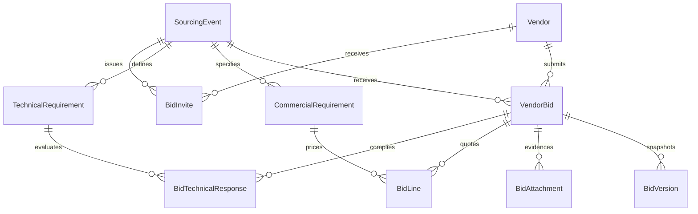
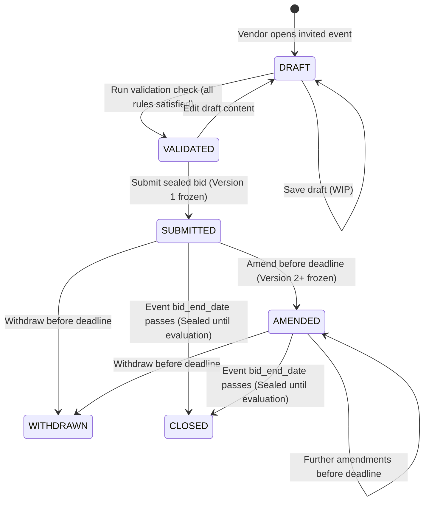

# Architecture Document — Vendor Bid Portal

> **Module:** Vendor Bid Portal  
> **PRD Ref:** HPE-PRD-2026-PROC01 — Section 6 / Section 7 (RFQ/RFP Sourcing + Vendor Bid Portal)  
> **Repository:** `VPDTechnologies/ProcureSphere_360`  
> **Status:** Production-Ready & Automated Tests Verified (77/77 tests passing)  

---

## 1. Purpose & PRD Mapping

The **Vendor Bid Portal** provides an isolated, highly secure, workflow-governed workspace where invited vendors prepare, validate, attach evidence to, submit, and amend sealed bids against published RFQ/RFP sourcing events.

### PRD Requirement Statement:
> *"Restricted bid submission, validation, attachments, amendment before close and sealed visibility."*

### Key Responsibilities:
- **Vendor User:** Restricted self-service: access invited events only, draft responses, enter technical compliance & commercial BOQ unit prices, attach documents, validate, submit sealed bids, amend before closing deadline.
- **Procurement Executive:** Oversight of invited vendors, monitor submission status and validation readiness during `BID_WINDOW` without breaching sealed commercial confidentiality, review submissions once deadline closes.
- **Deferred to Next Module (Evaluation & Award):** Technical scoring, weighted criteria evaluation, commercial comparison/ranking, award recommendations, award approvals.

---

## 2. Component Architecture & Data Relationships

The Vendor Bid Portal cleanly extends the `apps.sourcing` module, avoiding redundant schemas and preserving foreign-key referential integrity across the procurement workflow:

---

## 3. Bid Lifecycle State Machine

Bid progression is strictly managed in domain code (`apps.sourcing.services`):

### State Definitions:
1. **DRAFT:** Work in progress. Vendor can edit summary, technical compliance, and commercial line items. Validation has not run or was invalidated by recent changes.
2. **VALIDATED:** Server-side validation has verified all mandatory technical responses and positive commercial quotes. Ready for final submission.
3. **SUBMITTED:** The bid is locked and sealed. An immutable `BidVersion` (v1) snapshot is generated. Bidder details and pricing remain sealed from competitors and internal reviewers.
4. **AMENDED:** An update submitted before the deadline. Creates a new immutable `BidVersion` (v2, v3, etc.) while archiving earlier versions.
5. **CLOSED:** The event deadline has passed. The bid cannot be edited, amended, or withdrawn. Ready for technical & commercial evaluation.
6. **WITHDRAWN:** Explicitly retracted by the vendor prior to the deadline.

---

## 4. Vendor Access Model & Sealed Visibility

### Multi-Tenant Isolation Matrix
| Actor | Own Bid | Competitor Bids | Event Requirements | Pricing Lines in BID_WINDOW |
|---|---|---|---|---|
| **Vendor A** | Full Edit / View | **FORBIDDEN (403/404)** | View Allowed | Full View (Own Only) |
| **Vendor B** | Full Edit / View | **FORBIDDEN (403/404)** | View Allowed | Full View (Own Only) |
| **Procurement Executive** | Read (Post-Window) | Read (Post-Window) | Full Manage | **SEALED (Masked in BID_WINDOW)** |
| **Uninvited Vendor** | **FORBIDDEN (403)** | **FORBIDDEN (403)** | **FORBIDDEN (403)** | **FORBIDDEN (403)** |

### IDOR / BOLA Prevention
- Every URL parameter (`bid_id`, `attachment_id`, `version_number`) is verified through `get_vendor_bid_by_id_scoped(bid_id, user)`.
- If a vendor requests another vendor's bid or attachment, the system raises HTTP 403 Forbidden or HTTP 404 Not Found to prevent ID enumeration.
- Direct static file URLs are blocked: downloads go through `/sourcing/bids/attachments/<id>/download/`, which verifies active session and vendor ownership.

---

## 5. Bid Validation Engine

Server-side validation (`validate_bid_submission_service`) executes atomically and authoritatively:
1. **Event Status:** Event must be currently in `STATUS_BID_WINDOW`.
2. **Server-Side Timestamp:** `bid_start_date <= timezone.now() <= bid_end_date`. Browser timestamps are never trusted.
3. **Vendor Eligibility:** Vendor must be in `ACTIVE` or `APPROVED` standing; `SUSPENDED` vendors are strictly blocked.
4. **Invitation Check:** Vendor must hold an explicit `BidInvite` for the event.
5. **Technical Completeness:** If `technical_section_enabled`, every `MANDATORY` technical requirement must have a non-empty `response_text` and cannot be marked `NON_COMPLIANT`.
6. **Commercial Completeness:** If `commercial_section_enabled`, every commercial requirement must have a positive quoted price (`quoted_unit_price > 0`) and quantity (`quantity > 0`).
7. **Total Amount:** `total_bid_amount` must exceed zero.

---

## 6. Document Attachments & Security

- **Storage Abstraction:** Handled via Django's secure `FileField` with storage path `bid_attachments/%Y/%m/`.
- **Validation:** Enforced by `apps.core.validators.validate_file_upload`:
  - **Permitted Extensions:** `pdf`, `png`, `jpg`, `jpeg`, `doc`, `docx`, `xlsx`, `csv`. Executables (`.exe`, `.sh`, `.bat`) are rejected immediately.
  - **Size Limit:** Configured and enforced at **10 MB** maximum per file.
- **Authorization:** Only the owning vendor can upload or delete attachments during an open bid window. Procurement users can download attachments only after the bid window closes.

---

## 7. Bid Amendments & Immutable Versioning

The PRD mandates "amendment before close" while strictly preserving history:
- When a vendor amends a bid before the deadline:
  1. Vendor provides a mandatory `change_summary`.
  2. The amendment is re-validated against all event rules.
  3. `current_version_number` increments (e.g. 1 -> 2).
  4. An immutable `BidVersion` record is created containing a frozen JSON `snapshot` of all responses, commercial lines, and attachments.
  5. Prior `BidVersion` records are **immutable** and cannot be deleted or overwritten.
  6. Amendments after `bid_end_date` are rejected server-side.

---

## 8. Audit Trail & Compliance

Every critical operation writes an immutable `AuditLog` entry:
- `VendorBid` created (Draft initialized)
- `VendorBid` updated (Draft saved)
- `VendorBid` validation executed
- `VendorBid` submitted (Sealed)
- `VendorBid` amended (New version created)
- `VendorBid` withdrawn
- `BidAttachment` uploaded / deleted

---

## 9. API Endpoints (`/api/v1/sourcing/`)

| Method | Endpoint | Description | Scoped Access |
|---|---|---|---|
| `GET` | `/api/v1/sourcing/events/` | List accessible sourcing events | Invited Vendor / Procurement |
| `GET` | `/api/v1/sourcing/events/{id}/` | Retrieve sourcing event details | Invited Vendor / Procurement |
| `GET` | `/api/v1/sourcing/bids/` | List vendor's own bids | Vendor User (Own Only) |
| `GET` | `/api/v1/sourcing/bids/{id}/` | Retrieve bid details | Vendor (Own) / Procurement (Post-Window) |
| `POST` | `/api/v1/sourcing/bids/{id}/save-draft/` | Save WIP responses | Bid Owner Vendor |
| `POST` | `/api/v1/sourcing/bids/{id}/validate/` | Run validation check | Bid Owner Vendor |
| `POST` | `/api/v1/sourcing/bids/{id}/submit/` | Submit sealed bid (v1) | Bid Owner Vendor |
| `POST` | `/api/v1/sourcing/bids/{id}/amend/` | Submit amendment (v2+) | Bid Owner Vendor |
| `GET` | `/api/v1/sourcing/bids/{id}/attachments/` | List bid attachments | Bid Owner / Procurement (Post-Window) |
| `POST` | `/api/v1/sourcing/bids/{id}/attachments/` | Upload supporting doc | Bid Owner Vendor |
| `GET` | `/api/v1/sourcing/bids/{id}/versions/` | List historical versions | Bid Owner / Procurement (Post-Window) |

---

## 10. Web Interface (Templates)

1. `templates/pages/sourcing/vendor_bid_workspace.html`: Unified tabbed workspace (Overview, Technical Compliance, Commercial BOQ, Document Attachments, Validation & Submit, Version History).
2. `templates/pages/sourcing/bid_version_detail.html`: Immutable audit snapshot viewer for any historical or current `BidVersion`.
3. `templates/pages/sourcing/procurement_bids_list.html`: Procurement Executive submission dashboard (enforces sealed privacy during `BID_WINDOW`).
4. `templates/pages/sourcing/procurement_bid_detail.html`: Detailed submission review for Procurement Executives once unsealed.
5. `templates/pages/sourcing/detail_vendor.html`: Updated with "Open Bid Workspace" CTAs in header and sidebar.
6. `templates/pages/sourcing/detail.html`: Updated with "View Submissions" action button.

---

## 11. Implementation & Testing Status

### IMPLEMENTED
- [x] Database models: `VendorBid`, `BidTechnicalResponse`, `BidLine`, `BidAttachment`, `BidVersion` with normalized FKs and constraints.
- [x] Domain services: `get_or_create_vendor_bid_service`, `save_bid_draft_service`, `validate_bid_submission_service`, `submit_vendor_bid_service`, `amend_vendor_bid_service`, `upload_bid_attachment_service`, `delete_bid_attachment_service`, `withdraw_vendor_bid_service`.
- [x] Strict server-side deadline enforcement against `timezone.now()`.
- [x] Sealed bid privacy and multi-tenant isolation.
- [x] Protected file downloads with ownership verification (`vendor_bid_download_attachment_view`).
- [x] CSRF enforcement on all state-changing endpoints.
- [x] REST API endpoints (`VendorBidViewSet`, `SourcingEventViewSet`).
- [x] Enterprise responsive UI templates.
- [x] Append-only audit logging for all bid transitions.

### TESTED (77/77 tests passing — 100%)
- [x] `tests/test_demo_3_sealed_sourcing.py`: 1/1 Day-90 acceptance demonstration.
- [x] `src/apps/sourcing/tests/test_sourcing.py`: 34/34 sourcing lifecycle & RBAC tests.
- [x] `src/apps/sourcing/tests/test_vendor_bid_portal.py`: 42/42 dedicated tests covering models, validation, deadline enforcement, sealed visibility, attachments, amendments, CSRF, IDOR/BOLA, audit logging, and REST APIs.

### PENDING (Deferred to Evaluation & Award Module)
- [ ] Technical scoring and evaluator criteria sheets.
- [ ] Weighted commercial / technical ranking.
- [ ] Award recommendations and multi-level award approvals.
- [ ] PO generation from winning award.
